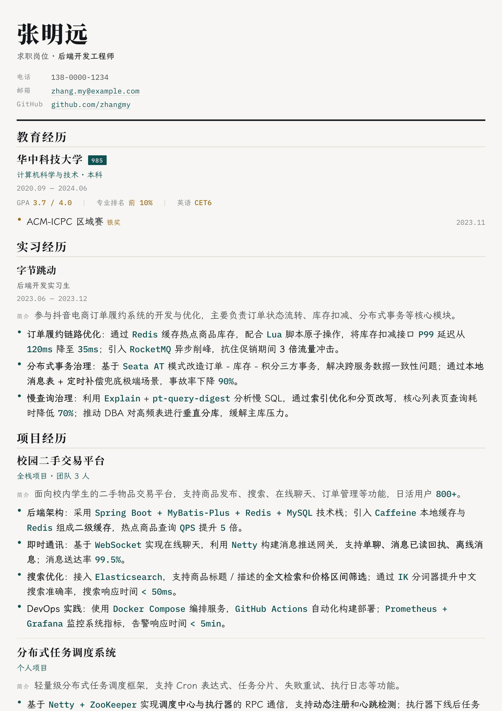
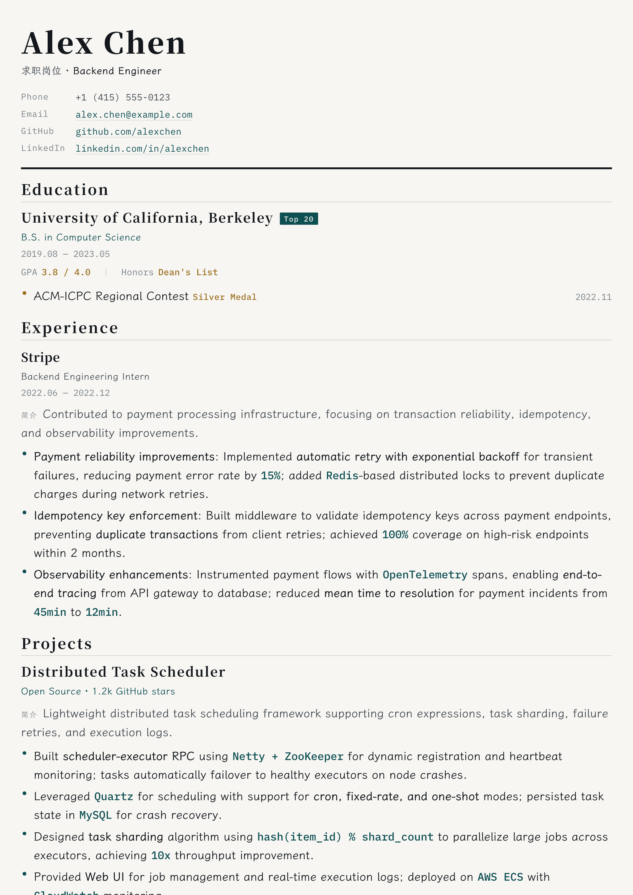
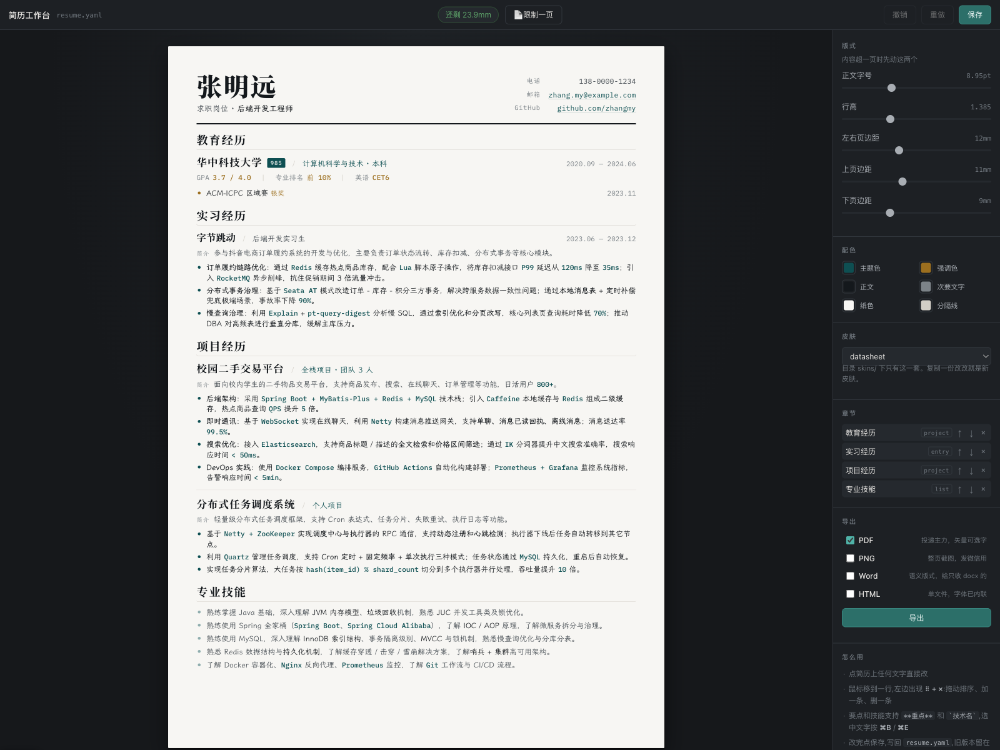

# resume-kit

简历工作台 —— 在浏览器里直接编辑简历，可导出为 PDF、Word、PNG、单文件 HTML。

数据存在 `resume.yaml` 里，纯文本、可 diff、可回滚。工作台只是它的编辑器。

## 效果一览

示例图片由仓库内的 `resume-zh-demo.yaml` 和 `resume-en-demo.yaml` 实际导出；
工作台截图展示的是同一套真实排版与导出选项。

<table>
  <thead>
    <tr>
      <th>中文简历导出</th>
      <th>English resume export</th>
    </tr>
  </thead>
  <tbody>
    <tr>
      <td></td>
      <td></td>
    </tr>
  </tbody>
</table>

### 工作台



## 上手

```bash
npm install
npm run fonts
npm run studio
```

**首次使用**：项目里自带了三个简历文件：

- `resume.yaml` — 默认加载的简历（中文示例）
- `resume-zh-demo.yaml` — 中文示例简历
- `resume-en-demo.yaml` — 英文示例简历

把你要编辑的简历命名为 `resume.yaml`，或者直接在工作台里修改现有的示例。

`npm run fonts` 把霞鹜文楷按简历实际用到的字裁成小分片放进 `fonts/`。
这一步不能跳：缺了字体，中文正文会回落到系统字体，行高全变，
"刚好一页"的判断就是假的。简历后来加了生僻字，再跑一次。

`npm run studio` 起服务并打开浏览器（默认 5173，端口占了就 `-- --port=5174`）。

## 工作台怎么用

左边是纸，右边是旋钮。纸上看到的就是导出来的东西 —— 同一套 CSS，不是近似预览。

- **改字**：点简历上任何文字直接改。Enter 提交，Esc 取消。
- **加 / 删 / 排序**：鼠标移到某一行，左边浮出 `⠿ + ×`。拖 `⠿` 排序。
- **行内标记**：要点和技能支持 `**重点**`、\`技术名\` 和 `[文字](地址)`。
  选中文字按 ⌘B / ⌘E，或者用浮出来的小工具条。编辑时显示原始标记，退出编辑就渲染回来。
  链接在 PDF / HTML / Word 里都能点，地址只认 `http(s)://`、`mailto:`、`tel:` 开头的。
- **版式**：右侧滑块调字号、行高、页边距。拖的时候纸立刻变 —— 走 CSS 变量，不重渲染。
  数值双击回到皮肤默认。
- **章节**：右侧列表里改顺序、切形态（`entry` / `project` / `list`）、删整段。
- **存盘**：⌘S 或点保存，写回 `resume.yaml`。旧版本自动留在 `.studio-backups/`（保留最近 20 份）。

顶栏中间那个徽标一直在量排版：

| 显示 | 意思 |
| --- | --- |
| 还剩 N mm | 一页装得下，还有余量 |
| 正好一页，没有余量 | 刚好，再加内容就要溢出 |
| 压进下边距 N mm | 没丢内容，但页脚很挤 |
| 超出一页 N mm | **末尾内容会被裁掉**，必须处理 |
| 约 N 页，末页还剩 M mm | 不限页数模式下的页数估算 |

倒数第二种是真会丢字的：`.sheet` 是固定高度 + `overflow:hidden`，
超出的部分屏幕上和 PDF 里都不显示，只是凭空消失。所以要主动量。

### 不限页数

单页是默认，也是简历的常态。内容确实放不下时，把 `meta.pages` 写成 `auto`
（或者顶栏点「限制一页」切成「不限页数」），纸张就按内容长高、PDF 自然分页，
分页点也会避开"标题落在页底"和"一段被劈成两半"。

```yaml
meta:
  pages: auto    # 1 = 单页且超出即裁；auto 或大于 1 = 按内容分页
```

工作台那个开关改的就是这个字段，存盘会写进 `resume.yaml`，下次打开还在。

## 导出

右侧勾格式，点导出，产物在 `dist/`。

| 格式 | 用途 | 说明 |
| --- | --- | --- |
| PDF | 投递主力 | 矢量、可选字，和纸上一模一样 |
| PNG | 发微信 / 贴聊天 | 3 倍图，2382×3369 |
| Word | 只收 docx 的地方 | **语义版式**，见下 |
| 单文件 HTML | 随手发一份 | 字体已内联，约 7MB，拷到哪都一个样 |

DOCX 是另一条路，不是 PDF 的像素复刻。Word 的段落流装不下皮肤那套 CSS
栅格，硬凑只会得到一个两边都不像的东西。它保证三件事：层级结构对（ATS 能解析）、
加粗和技术名的强调保留、配色跟皮肤一致。日期用制表位右对齐而不是表格 ——
有些 ATS 解析表格会把顺序打乱。

## 命令

```bash
npm run studio   # 工作台（推荐）
npm run build    # YAML → dist/*.html，顺带量一次排版
npm run pdf      # YAML → PDF，内容被裁时退出码 2
npm run dev      # 改 YAML 自动刷新浏览器（不带编辑功能）
npm run check    # 只校验数据
npm run fonts    # 重新生成字体子集
npm test         # YAML 序列化往返测试
```

`npm run pdf` 在内容被裁时退出码为 2，可以挂在 CI 上。加 `--allow-clip` 忽略。

## 目录

```
resume.yaml          简历数据，唯一的真相
skins/datasheet/     一套皮肤 = template.hbs + style.css
fonts/               字体（lxgw 子集由 npm run fonts 生成，不进仓库）
src/
  cli.js             命令入口
  data.js            载入、校验、路径标记
  render.js          数据 + 皮肤 → HTML
  markup.js          **重点** / `技术名` / [链接](地址) 的唯一定义（前后端共用）
  emit-yaml.js       数据 → YAML（保存路径，改动前先跑 npm test）
  fit-probe.js       量排版，注入到页面里
  pdf.js             headless Chrome → PDF / PNG
  docx.js            → Word
  zip.js             最小 ZIP 写入器（docx 就是个 zip）
  export.js          四种格式的总入口
  studio.js          工作台服务端
  studio/            工作台前端（editor 主控 / paper 编辑引擎 / knobs 面板）
```

## 想改皮肤

复制 `skins/datasheet/` 改个名字，`resume.yaml` 里 `meta.skin` 指过去。
皮肤只管长相 —— 纸多大、超出裁不裁、怎么分页由 `src/page-css.js`
的基础层统一给，对所有皮肤一视同仁。三个约定要守住：

- 模板里的 `data-bind` / `data-row` / `data-list` 属性是工作台的编辑入口，
  照抄过去，不然纸上点不动。
- `<html>` 上的 `data-page-mm="{{meta.paper.h}}"` 照抄，排版探针靠它知道纸多高。
- 别给 `.sheet` 写 `width` / `height` / `overflow`，也别写 `@page` ——
  那些是基础层的事，皮肤写了会跟换纸打架。

窄屏断点写成占位符 `@media screen and (max-width:NARROW)`，
渲染时替换成「纸宽 + 26px」。别写死数值：A4 在 96dpi 下是 793.7px，
断点压到这个数以上，工作台里的纸会命中手机那套规则。

英文简历在 `meta` 里写 `lang: en`：页头的「求职岗位」、默认的「简介」标签、
Word 文档标题和单文件 HTML 的文件名后缀都会换成英文。不写就是中文。

换纸在 `resume.yaml` 里写 `meta.paper`（`A4` / `A3` / `A5` / `Letter` /
`Legal`，或 `210x297` 这样的毫米尺寸），横向再加 `orientation: landscape`。

## 注意

- 保存会重写整个 `resume.yaml`：注释按章节标题重新生成，字符串该加引号的加上。
  内容不会变（`npm test` 里有一组断言守着往返一致），但格式会被统一一次。
