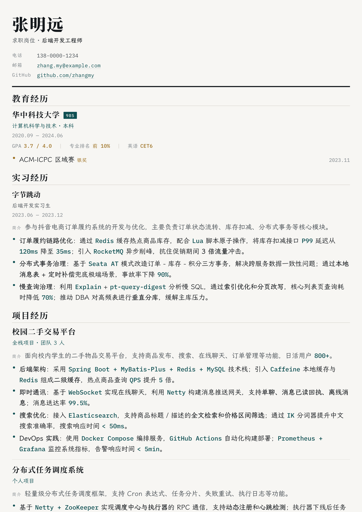
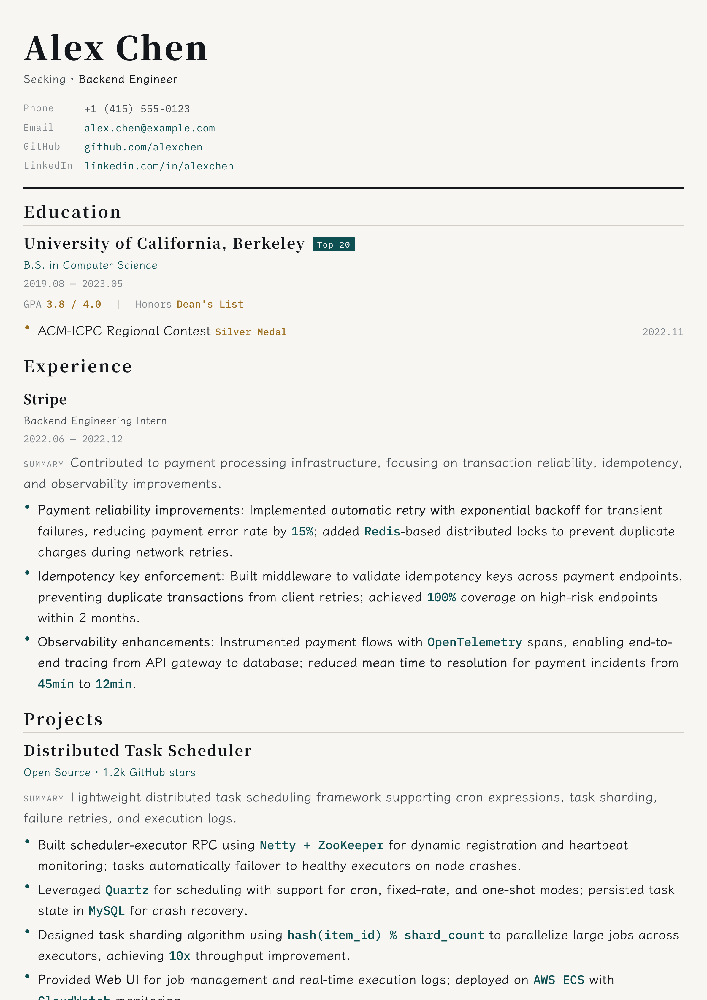
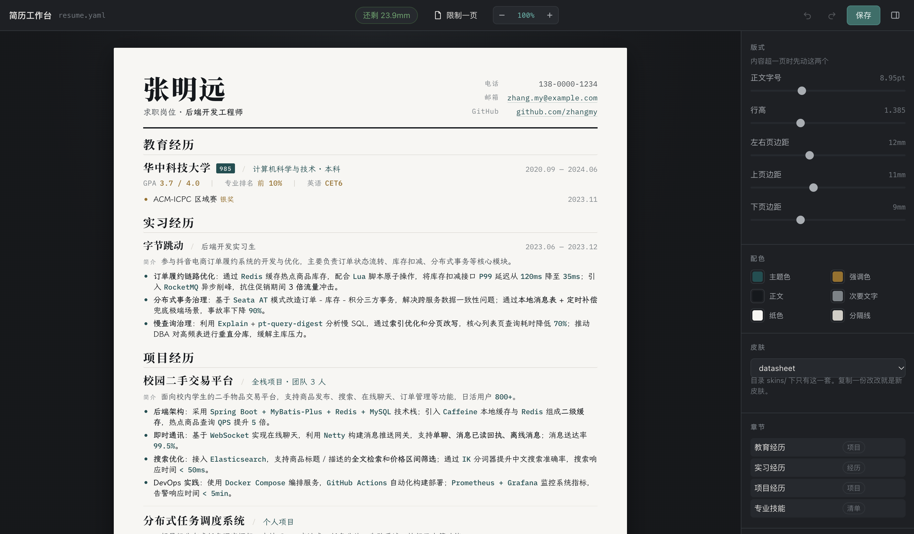

[English](README.md) | 简体中文

# resume-kit

简历工作台 —— 在浏览器里直接编辑简历，可导出为 PDF、Word、PNG、单文件 HTML。

数据存在 `resume.yaml` 里，纯文本、可 diff、可回滚。工作台只是它的编辑器。

## 效果一览

示例图片由仓库内的 `resume-zh-demo.yaml` 和 `resume-en-demo.yaml` 实际导出；工作台截图展示当前编辑器和真实简历预览。

<table>
  <thead>
    <tr>
      <th>中文简历导出</th>
      <th>English resume export</th>
    </tr>
  </thead>
  <tbody>
    <tr>
      <td></td>
      <td></td>
    </tr>
  </tbody>
</table>

### 工作台



## 上手

```bash
npm install
npm run fonts
npm run studio
```

项目自带三个简历文件：

- `resume.yaml` — 默认加载的中文示例
- `resume-zh-demo.yaml` — 中文示例简历
- `resume-en-demo.yaml` — 英文示例简历

把要编辑的简历命名为 `resume.yaml`，即可默认加载。也可以通过 `npm run studio -- --data=resume-en-demo.yaml` 这样的命令直接编辑示例文件。

`npm run fonts` 会按简历实际用到的字生成霞鹜文楷字体子集，放入 `fonts/`。准确显示中文和测量分页都需要这一步。简历后来加了子集里没有的字，再运行一次。

`npm run studio` 默认在 5173 端口启动。端口被占用时，可运行 `npm run studio -- --port=5174`。

## 工作台怎么用

工作台直接编辑排版后的简历，预览和导出使用同一套 CSS。

- **改字**：点简历上的文字直接编辑，Enter 提交，Esc 取消。
- **加、删、排序**：鼠标移到一行，左侧会显示 `+` 和 `⠿`。拖动 `⠿` 可调整顺序。
- **行内标记**：要点和技能支持 `**重点**`、`` `技术名` `` 和 `[文字](地址)`。选中文字按 ⌘B / ⌘E / ⌘K，或使用浮动工具条。链接支持 `http(s)://`、`mailto:` 和 `tel:` 地址。
- **版式**：在右侧调字号、行高和页边距，改动会立即反映在简历上。双击数值可恢复皮肤默认值。
- **章节**：在右侧列表调整顺序、切换形态（`entry` / `project` / `list` / `text`）或删除章节。
- **存盘**：按 ⌘S 或点保存，写回 `resume.yaml`。最近 20 份备份保存在 `.studio-backups/`。

顶栏的排版提示会显示剩余空间、内容是否挤入底部留白，以及是否超出纸面。在单页模式下，`.sheet` 高度固定且会隐藏溢出内容，因此被裁掉的内容在 PDF 中也不会出现。编辑后请检查提示。

### 不限页数

默认是单页。内容确实放不下时，把 `meta.pages` 设成 `auto`，或在工作台切换到多页模式。纸张会随内容增长，PDF 分页时会尽量避免标题或单条经历被拆开。

```yaml
meta:
  pages: auto # 1 = 单页；auto 或大于 1 的数字 = 按内容分页
```

工作台的开关会更新 `resume.yaml` 中的这个字段并保存。

## 导出

在右侧选择一种或多种格式，点击导出，文件会写入 `dist/`。

| 格式 | 用途 | 说明 |
| --- | --- | --- |
| PDF | 投递 | 矢量、可选字，和简历页面一致 |
| PNG | 分享或聊天 | 3 倍图，A4 为 2382 × 3369 |
| Word | 只收 DOCX 的平台 | 语义版式，详见下文 |
| 单文件 HTML | 分享网页简历 | 字体已内嵌，约 7 MB |

DOCX 是语义版式导出，不追求像素级复刻 PDF。它保留文档层级以便 ATS 解析，也保留强调样式和皮肤配色。日期使用右对齐制表位而不是表格，因为有些 ATS 会打乱表格内容顺序。

## 命令

```bash
npm run studio   # 打开简历工作台
npm run build    # YAML → dist/*.html，并测量排版
npm run pdf      # YAML → PDF；内容被裁时退出码为 2
npm run dev      # 修改 YAML 时自动刷新预览（不带编辑功能）
npm run check    # 校验简历数据
npm run fonts    # 重新生成字体子集
npm test         # 测试 YAML 序列化往返
```

运行 `npm run pdf -- --allow-clip` 可允许内容被裁时继续完成 PDF 构建。

## 目录

```text
resume.yaml          简历数据
skins/datasheet/     皮肤模板和样式
fonts/               字体（霞鹜文楷子集由 npm run fonts 生成）
src/
  cli.js             命令入口
  data.js            载入、校验和索引简历数据
  render.js          数据与皮肤渲染为 HTML
  markup.js          编辑器和导出器共用的行内标记解析
  emit-yaml.js       数据序列化回 YAML
  fit-probe.js       测量页面排版
  pdf.js             使用无头 Chrome 导出 PDF 和 PNG
  docx.js            Word 导出
  zip.js             DOCX 使用的最小 ZIP 写入器
  export.js          导出流程
  studio.js          工作台服务端
  studio/            编辑器、简历编辑引擎和侧栏
```

## 皮肤

复制 `skins/datasheet/` 到新目录，并在 `resume.yaml` 的 `meta.skin` 中指定目录名。皮肤控制外观；纸张尺寸和分页由 `src/page-css.js` 中的共享规则控制。

- 保留模板的 `data-bind`、`data-row`、`data-list` 属性，工作台才能编辑内容。
- 保留 `<html>` 上的 `data-page-mm="{{meta.paper.h}}"`，排版探针需要用它读取纸张高度。
- 不要给 `.sheet` 设置宽度、高度或 overflow，也不要定义 `@page`；这些值由共享页面规则管理。
- 窄屏断点写成 `@media screen and (max-width:NARROW)`。渲染时会将 `NARROW` 替换为纸张宽度加 26px。

英文简历在 `meta` 中设置 `lang: en`。页头前缀、默认简介标签、未命名章节、DOCX 标题和单文件 HTML 文件名会相应显示为英文。不设置时默认中文。

`meta.paper` 支持 `A4`、`A3`、`A5`、`Letter`、`Legal`，或 `210x297` 这样的毫米尺寸。横向纸张再设置 `orientation: landscape`。

## 注意

保存会重写整个 `resume.yaml`，并按章节标题重新生成注释。数据会保留，但 YAML 格式可能统一；`npm test` 会检查序列化往返结果。
